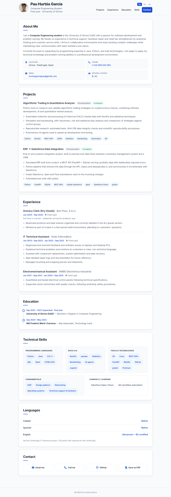
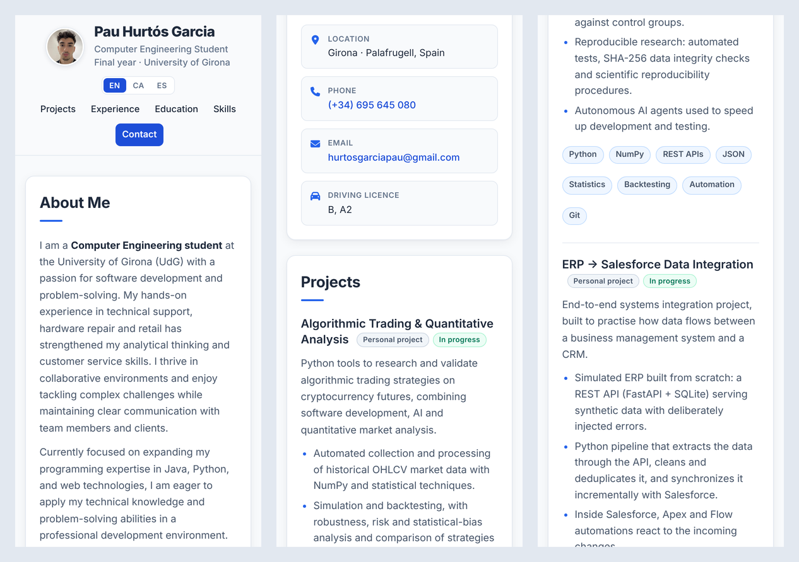

# Design notes

Design analysis behind the web CV. See the [README](README.md) for an overview of the project.

## Final design

The page as it is published, on desktop (1280 px) and on mobile (390 px).

### Desktop

### Mobile

## User Persona

The CV is designed for **recruiters and HR professionals** who review applications for technical positions. This target audience typically:

**Needs:**
- Review CVs quickly (average time: 30 seconds per CV)
- Identify relevant technical skills immediately
- Evaluate work experience and academic background
- Easily contact the candidate

**Behavior:**
- Uses mobile and desktop devices interchangeably
- Prefers clean and professional designs
- Values clarity in information organization
- Needs quick access to contact information

**CV Objectives:**
- Highlight technical skills relevant for development positions
- Show practical experience in technical support and hardware
- Demonstrate ongoing academic training
- Facilitate contact through multiple channels

---

## Information Architecture

The CV's information architecture is designed following a hierarchical and logical structure that allows users to quickly find the information they are looking for. The design uses an "above the fold" approach to display the most critical information first, followed by complementary content organized in clearly defined sections.

The page begins with a **sticky header** that remains visible during scrolling, containing the main identification (avatar, name, and tagline) along with navigation that allows quick access to any section through anchor links. This horizontal navigation optimizes space and maintains accessibility across all sections.

The main content is organized into **independent sections** contained in visually differentiated cards. Each section serves a specific purpose: **About Me** provides personal and professional context, **Experience** shows work history with chronological details, **Education** presents academic background in timeline format, **Technical Skills** groups competencies into logical categories, **Soft Skills** complements technical abilities, **Languages** highlights linguistic capabilities, and finally **Contact** offers multiple communication methods.

The organization follows a **visual hierarchy** pattern where the most important elements (name, recent experience, main skills) appear first, while complementary information (soft skills, additional details) is placed at the end. Each section uses a consistent spacing system and visual elements such as decorative lines under titles to establish clear separation and visual hierarchy.

The navigation structure is optimized for both quick scanning and detailed reading. Users can jump to specific sections using the sticky navigation menu, or scroll naturally through the content. The card-based layout creates visual breaks that make it easy to digest information in chunks, while maintaining a cohesive overall design.

---

## Visual Design

The CV's visual design is grounded in modern and minimalist design principles, using a carefully selected color palette that conveys professionalism and trust. The main palette is based on blue tones (#2563eb, #1d4ed8) as the brand color, which communicates technology and reliability, combined with a light neutral background (#f8fafc) that reduces visual fatigue and dark text (#1e293b) that ensures excellent readability.

The typography uses a single typeface, **Inter**, for everything: body text, interface elements and the name, which is set in an extra-bold weight with slightly tighter letter spacing. A single family keeps the page modern and consistent. Font sizes are scaled hierarchically: 28px for the name, 24px for section titles, 18px for job titles, and 16px for body text, creating a clear visual hierarchy.

The design implements a **card system** with rounded corners (14px radius), thin neutral borders and soft shadows that create depth without being intrusive. Hover effects are deliberately subtle (a slightly stronger shadow, a colour change on buttons) so that nothing on the page moves or shifts while it is being read. Skill tags use a light blue background with dark blue text, and contact buttons fill with the brand colour on hover.

Decorative elements include accent lines under section titles and a vertical timeline for education. The design is fully responsive, adapting from mobile devices to large desktop screens, maintaining readability and usability across all screen sizes. The color contrast ratios meet WCAG AA standards, ensuring accessibility for users with visual impairments, while the generous spacing and clear typography enhance readability for all users.
