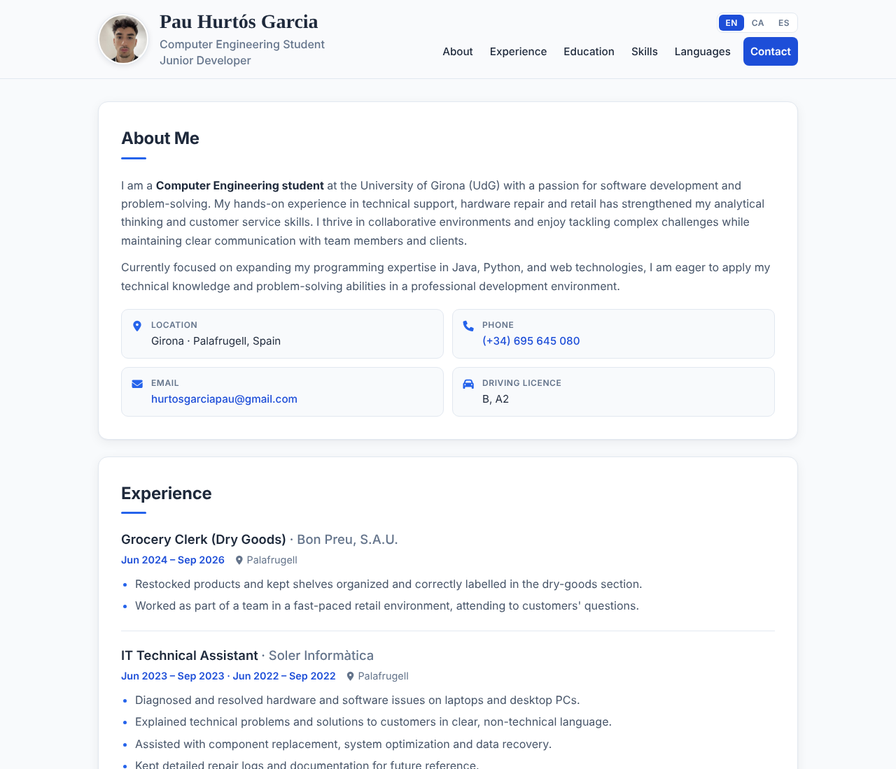

# Pau Hurtós Garcia — Curriculum Vitae

[](https://pdpxvx.github.io/CV/)


My personal web CV: a single responsive page built with plain HTML and CSS and published with GitHub Pages.
No frameworks, no build step.

**🌐 Live:** [English](https://pdpxvx.github.io/CV/) · [Català](https://pdpxvx.github.io/CV/ca/) · [Español](https://pdpxvx.github.io/CV/es/)



---

## Features

- **Three languages** — English, Catalan and Spanish, with a language switcher in the header and `hreflang` links for search engines.
- **Responsive** — works on mobile, tablet and desktop.
- **Print-ready** — the *Save as PDF* button (or `Ctrl+P`) produces a clean two-page A4 CV.
- **Accessible** — semantic HTML5, skip link, visible keyboard focus, WCAG AA colour contrast, and `prefers-reduced-motion` support.
- **Shareable** — Open Graph tags give a proper preview when the link is posted on LinkedIn, WhatsApp, etc.
- **Lightweight** — one HTML file and one CSS file. The only external resources are Google Fonts and Font Awesome (loaded with an SRI hash).

## Project structure

```
.
├── docs/                 # Published by GitHub Pages
│   ├── index.html        # CV in English (default)
│   ├── ca/index.html     # CV in Catalan
│   ├── es/index.html     # CV in Spanish
│   ├── style.css         # Shared styles (screen + print)
│   └── assets/
│       └── photo.jpg     # Profile photo (square, 400×400)
├── .github/preview.png   # Screenshot used in this README
├── DESIGN.md             # Design analysis: user persona, information architecture, visual design
└── README.md
```

## Run locally

Open `docs/index.html` in a browser, or serve the folder:

```bash
cd docs
python3 -m http.server 8000
# then open http://localhost:8000
```

## Updating the CV

1. Edit the content in `docs/index.html`, `docs/ca/index.html` and `docs/es/index.html` (keep the three versions in sync). Each section is marked with a comment.
2. To change the photo, replace `docs/assets/photo.jpg` with a square image using the same file name.
3. Commit and push to `main`. GitHub Pages redeploys automatically in 1–2 minutes.

## Design

The design was prototyped in Figma before it was built:
[view the Figma project](https://www.figma.com/design/PcGF9UbmOhA7uRje0PY9a1/CV---Pau-Hurt%C3%B3s-Garcia?node-id=0-1&t=6rTlBFjUgqRxiIZl-1).
The reasoning behind the layout, colours and typography is documented in [DESIGN.md](DESIGN.md).

## Contact

- Email: [hurtosgarciapau@gmail.com](mailto:hurtosgarciapau@gmail.com)
- GitHub: [@pdpxvx](https://github.com/pdpxvx)

---

© Pau Hurtós Garcia. The content of this CV (text and photo) is personal and may not be reused.
